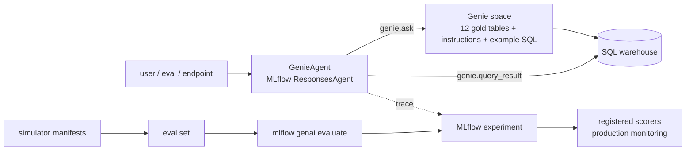

# Genie agent (MLflow traced, evaluated and monitored)

A natural-language front end to the gold marts. Ask "How many orders were cancelled in Pune on
2026-09-12?" and Genie writes the SQL, runs it on the SQL warehouse and answers. Every question
produces an MLflow trace. An evaluation set with exact answers from the generator measures
accuracy, and registered scorers monitor live traffic. Design: [ADR 0008](adr/0008-genie-agent-mlflow.md).



## Setup

```bash
uv sync --group dev --group agent --extra databricks
export FD_SCHEMA=dev_<you>_fooddelivery               # the deployed target's schema (scripts/bundle_env.py)
```

Credentials: the default nightly-refresh token is scoped and gets 403 on Genie and MLflow. Use a
separate `~/.databrickscfg` profile with an **all-APIs** PAT (the scorer registry needs `all-apis`)
and pass `--profile <name>` to every `fd agent` command. The CLI also exports it as
`DATABRICKS_CONFIG_PROFILE`, so MLflow uses the same identity.

## Commands

| Command | Does |
|---|---|
| `fd agent space [--dry-run]` | Create or update the Genie space and print its id and URL. `--dry-run` prints the serialized space |
| `fd agent ask "question" [--conversation-id ID]` | One traced question. Prints the answer, SQL, conversation id and the trace URL |
| `fd agent eval --start D1 --end D2` | `mlflow.genai.evaluate` over the generated eval set. Use dates already in gold |
| `fd agent monitor [--sample-scale X] [--stop]` | Register and start (or stop) the production-monitoring scorers |
| `fd agent deploy [--register-only]` | Log the agent to UC (`<catalog>.<schema>_ops.genie_agent`) and serve it with Agent Framework |

`export FD_GENIE_SPACE_ID=<id from fd agent space>` before `ask`, `eval` and `deploy`.

## What a trace contains

| Span | Type | Inputs → outputs |
|---|---|---|
| `predict` | AGENT | Responses API request → answer text, plus `custom_outputs` (conversation id, status, SQL, row count) |
| `genie.ask` | TOOL | question, conversation id → Genie status, text, SQL, query description, suggested questions, error |
| `genie.query_result` | TOOL | conversation, message and attachment ids → result columns and rows |

Trace tags: `genie.space_id`, `genie.status`. Session = Genie conversation id.

## Scorers

| Scorer | Kind | Evaluation | Monitoring (sample rate) |
|---|---|---|---|
| `numeric_match` | code, against generator ground truth | ✓ | (no ground truth) |
| `genie_answered` | code: COMPLETED with a result table | ✓ | 100% |
| `sql_generated` | code: `genie.ask` produced SQL | ✓ | 100% |
| `genie_latency_s` | code: mean / p90 / max seconds | ✓ | 100% |
| `Correctness` | LLM judge vs `expected_facts` | ✓ | – |
| `RelevanceToQuery` | LLM judge | ✓ | 50% |
| `Safety` | LLM judge | ✓ | 100% |
| `answer_guidelines` | `Guidelines` judge: figures name city/date; says so when unanswerable | ✓ | 50% |

## Evaluation set

Built by `fooddelivery.agent.evalset` from the simulator's manifests for `--start..--end` (no
files written, same seed as the pipeline). With `--per-metric 3`: 18 point lookups (orders
placed, cancelled, late, no-rider cancellations, GMV, refunds), 3 cross-city totals, 3 GMV
rankings, a 7-day window and an out-of-scope question, 26 in total. The set is deterministic, so
runs before and after a space change compare like with like.

## Live results (Databricks Free Edition, dev target, 25 Nov 2026)

Space over `workspace.dev_rohit91jacob_fooddelivery_gold` (business dates 2026-09-01..17).
`fd agent eval --start 2026-09-01 --end 2026-09-17`: 26 questions, MLflow run `89cba383d259424ebe8b2475afdd2531`.

| Metric | Value |
|---|---|
| `numeric_match` (exact vs generator manifest, 25 questions with ground truth) | **1.00** |
| `correctness` (LLM judge) | 1.00 |
| `safety` | 1.00 |
| `genie_answered`, `sql_generated`, `relevance_to_query`, `answer_guidelines` | 0.96 |
| latency mean / p90 / max | 13.5 s / 15.1 s / 15.6 s |

The 0.96 scores all come from the out-of-scope question ("What will the weather be in Mumbai next
Friday?"). Genie correctly declined it, but the scorers counted the refusal as a miss.
`genie_answered` and `sql_generated` now honour `expect_refusal` in the eval set. The
relevance judge still marks a correct refusal as irrelevant, which is a known trait of that judge.

### Production monitoring (verified)

`fd agent monitor` registered and started all six scorers on experiment `2895128512865967`. A live
question ("Which city had the most late deliveries on 2026-09-10?", answer Mumbai, 135, which matches
the manifest) received all six assessments within minutes, without any manual step:
`genie_answered` True, `sql_generated` True, `genie_latency_s` 14.85, `safety` yes,
`relevance_to_query` yes, `answer_guidelines` yes.

### Deployment (verified)

`fd agent deploy` registered `workspace.dev_rohit91jacob_fooddelivery_ops.genie_agent` (v4) and
served it as the Agent Framework endpoint `agents_workspace-dev_rohit91jacob_fooddelivery_ops-genie_agent`
(scale to zero), with a Review App for human feedback. The endpoint reached READY and answered "How
many orders were placed across all cities on 2026-09-08?" with 3,055, which matches the manifest.
Anonymous requests get 401.

Two traps found on the way, both handled in code:
- **Models-from-code logged on Windows don't load on Linux serving.** MLmodel records the absolute
  `C:\...` path, and the container's POSIX `basename` can't split it. On Windows,
  `ops._log_from_windows` saves the model, rewrites `model_code_path` to `genie_agent.py`, then
  logs and registers it.
- **`ModelConfig` must be read at import time.** MLflow exposes the logged config only while it
  imports the model file, so the agent reads it at module load. Read inside `predict`, it was
  already gone.

## Known limitations

- The scorer registry needs a PAT with the **all-APIs** scope. Tokens with individual scopes get
  `403 ... required scopes: all-apis`.
- Genie's throughput limit makes evaluation slow by design (2 workers, backoff on 429).
- The relevance judge marks a correct refusal of an out-of-scope question as irrelevant.
